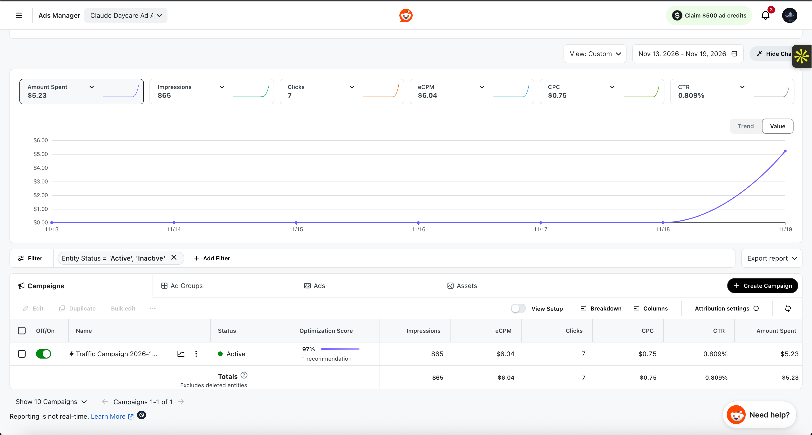

# Part 1 — Ad result (interim) and experiment card

**Owner:** Mitchell Rosenthal · **Platform:** Reddit Ads · **Read on:** Nov 19, 2026, 5:48 PM

## What happened

We created a Reddit traffic campaign on Nov 18. It began delivering between Nov 18 and Nov 19. We launched late, and we did not commit an experiment card before launch, which the course asked for. The card below is written after launch and is labelled that way.

## Interim numbers (Reddit Ads dashboard, Nov 13–19 view)

| Measure | Value |
|---|---|
| Status | Active |
| Amount spent | $5.23 |
| Impressions | 865 |
| Clicks | 7 |
| Click-through rate | 0.809% |
| Cost per click | $0.75 |
| Cost per 1,000 impressions | $6.04 |

**Sign-ups.** Our public count (https://claudedaycare.com/api/metrics) read 19 sign-ups on Nov 19 and 20 on Nov 20. We have not yet confirmed whether the new sign-up came from the ad.

**Google Analytics by UTM: missing.** We do not have this screenshot. We did not complete the tracking check before launch, so we cannot yet show ad visits and sign-ups by UTM. Mitchell is confirming the ad link's UTM tags; we will add the screenshot to this folder when we read the final result.

**Pass or fail:** not yet. The seven days end on Nov 25–26. We read the result once, then, against the bar below.

**What we noticed so far:** the campaign is spending slowly (about $5 in its first day against a seven-day budget), so we may not reach the click volume the test needs. Mitchell is checking the bid and targeting.

## Experiment card (written Nov 20, after launch)

1. **Question.** Should we keep paying for Reddit traffic to reach people who use coding agents?
2. **Hypothesis.** The Reddit ad will bring at least 5 sign-ups in seven days.
3. **The one variable.** We are testing the audience (Reddit users in coding-agent communities). The page, offer and budget are fixed.
4. **Audience.** Reddit users interested in Claude Code, Codex and AI coding. Our HW4 research found most discussion of unused plan usage and unattended runs in these communities.
5. **Setup.** Reddit Ads, traffic objective, seven days from first delivery (Nov 18–19 to Nov 25–26). A sign-up is a new account on claudedaycare.com. We read sign-ups from our own database. Tracking check: not completed before launch.
6. **The bar.** PASS at 5 or more sign-ups from the ad. FAIL at 1 or fewer. UNCLEAR in between. Because this bar was written after launch, with the first day's numbers visible, we treat a pass as weaker evidence than a pre-committed one.
7. **What we'll do.** If PASS: keep the Reddit ad running and test a second message. If FAIL: stop spending; a low click rate means the message or audience is off, and clicks without sign-ups mean the page is off. If UNCLEAR: do not spend more, and decide from usability sessions.
8. **Stop rules.** We touch the ad mid-test only if tracking is broken, the ad is disapproved, or spend runs over budget.
9. **Result (interim, Nov 19; final after the end date).**
   - Impressions: 865 · Clicks: 7 · Click rate: 0.809%
   - Sign-ups from the ad: not yet known · Sign-up rate: not yet known
   - Spend: $5.23 · Cost per sign-up: not yet known
   - **Call: UNCLEAR (interim).** We make the final call once, after the end date.
